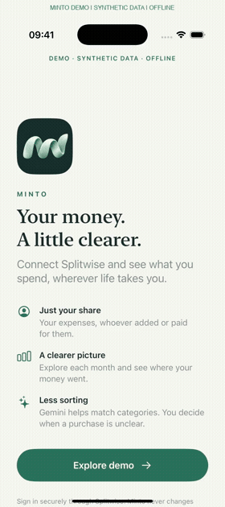
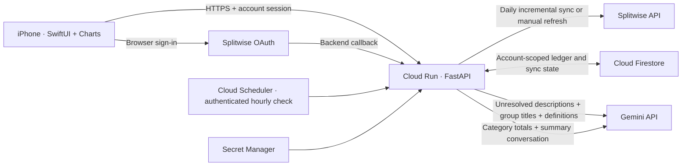

# Minto

**Your spending, in focus.** A native iOS app that turns your personal share of Splitwise expenses into clear monthly trends, category breakdowns, and conversational insights.

Minto is running as a small hosted beta. Splitwise is the source of expenses; Google Sheets is no longer part of the active data flow. TestFlight distribution is being prepared.

## See it in action

[](docs/media/minto-demo.mp4)

[Watch or download the simulator video](https://github.com/ash010413/splitwise-ledger/raw/refs/heads/main/docs/media/minto-demo.mp4). All shown accounts and transactions are fictional. The demo runs offline; its AI responses are illustrative.

## What it does

- Connect through Splitwise OAuth, with a secure session stored in the iPhone Keychain.
- Track **your owed share**, regardless of who paid or entered the expense. Exclude settlements and deleted expenses.
- Explore monthly or all-time spending, 3/6/12-month charts, and the transactions behind each category.
- Apply saved category choices and deterministic rules first; use Gemini when those rules cannot decide.
- Put unresolved historical purchases in **Others** after classification. Ask for your input on unclear new purchases.
- Ask Minto for a readable summary and follow-up explanations. Summary responses never change financial records.
- Sync daily and refresh manually with a pull gesture. Keep different currencies separate.

Automatic classification can be wrong. Categories remain editable, and explicit user choices take priority over automation.

## Architecture and data flow



1. OAuth verifies the Splitwise identity on the backend. Provider tokens stay encrypted on the server; a one-time exchange gives the app its own session.
2. The backend fetches expenses, normalizes each user's share, and updates records by source ID and revision. Repeated syncs do not duplicate purchases.
3. Category rules run before Gemini. User corrections are revision checked and can optionally become remembered matching rules.
4. Firestore persists each account's ledger, classification decisions, and sync cursor. The app reads this ledger and derives charts and transaction lists.
5. An hourly scheduler checks eligibility; each account normally fetches Splitwise at most once per 24 hours. Pull to refresh requests an immediate sync.

## Technical specifications

| Layer | Implementation |
| --- | --- |
| iPhone | SwiftUI, Swift Charts, iOS 17+, Keychain, local display cache |
| Backend | Python 3.11+, FastAPI, Authlib, decimal money arithmetic |
| Hosting | Google Cloud Run, `us-central1`, HTTPS, scales to zero |
| Persistence | Firestore Native mode; SQLite adapter for local development |
| Scheduling | Cloud Scheduler with OIDC authentication |
| Secrets | Google Secret Manager; no provider secrets in the app |
| AI | Server-side Gemini category matching and on-demand summaries |
| Deployment | Container build through Cloud Build and Artifact Registry |
| Beta limits | Four account slots; one Cloud Run instance, 1 CPU / 512 MiB |

Free-tier allowances help keep a small beta inexpensive; they are not a guarantee of zero charges. Account capacity is a limit, not an invitation system. Splitwise access also depends on the registered application's current API entitlement.

## Categories

Home · Car · Flights / Travel · Food / Dining · Groceries · Misc · Movie / Entertainment · Phone · AI · Badminton / Sports · Gym · Lux, plus **Others** for unresolved history. **Misc** means necessary spending or spending for others; **Lux** means discretionary purchases for yourself. Neither is a catch-all automatic guess. Full definitions and review behavior are in the [integration guide](docs/splitwise-beta.md).

## Development

```sh
python3 -m venv .venv
.venv/bin/pip install -r requirements.lock
.venv/bin/pip install --no-deps -e .
cp .env.example .env
# Configure local credentials and callback before connecting an account.
.venv/bin/uvicorn splitwise_ledger.api:create_app --factory --reload
```

Never commit `.env`, financial exports, database files, or personal Xcode configuration. The hosted build uploads only an allowlisted backend build context.

```sh
.venv/bin/pytest
.venv/bin/ruff check src tests tools
cd ios/LedgerCore
swift test
```

- [Architecture, correctness, and security boundaries](docs/architecture.md)
- [iOS setup and offline demo recording](ios/README.md)
- [Splitwise integration and category policy](docs/splitwise-beta.md)
- [Cloud deployment runbook](deploy/gcp/README.md)
- [TestFlight readiness and remaining work](docs/testflight.md)
