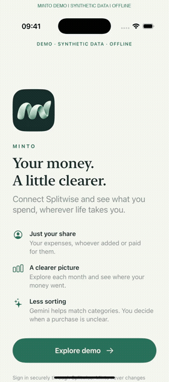
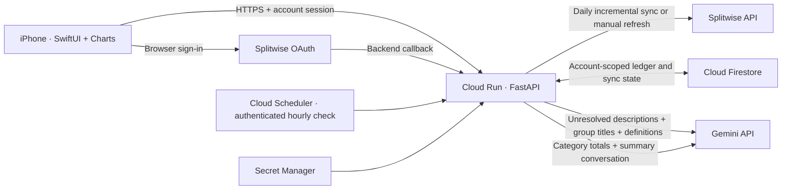

# Minto

**Your spending, in focus.** A native iOS app that turns your personal share of Splitwise expenses into clear monthly trends, category breakdowns, and conversational insights.

Minto is running as a small hosted beta. Splitwise is the source of expenses; Google Sheets is no longer part of the active data flow.

## See it in action

[](docs/media/minto-demo.mp4)

[Watch or download the simulator video](https://github.com/ash010413/splitwise-ledger/raw/refs/heads/main/docs/media/minto-demo.mp4). All shown accounts and transactions are fictional. The demo runs offline; its AI responses are illustrative.

## What it does

- Connect through Splitwise OAuth, with a secure session stored in the iPhone Keychain.
- Track **your owed share**, regardless of who paid or entered the expense. Exclude settlements and deleted expenses.
- Explore monthly or all-time spending, 3/6/12-month charts, and the transactions behind each category.
- Apply saved category choices and deterministic rules first; use Gemini when those rules cannot decide.
- Put unresolved historical purchases in **Others** after classification. Ask for your input on unclear new purchases.
- Compare current month-to-date spending with the same cutoff day last month; closed months use full-month comparisons.
- Ask Minto for a readable summary and follow-up explanations. Summary responses never change financial records.
- Sync daily and refresh manually with a pull gesture. Keep different currencies separate.

Automatic classification can be wrong. Categories remain editable, and explicit user choices take priority over automation.

## Install on your iPhone

You will build your own copy of Minto using your own Apple Account. You do **not** need a paid Apple Developer membership for this personal-device installation. Free signing lasts **7 days**, so plan to reconnect and rebuild regularly. Apple's [Personal Team limitations](https://developer.apple.com/help/account/basics/about-your-developer-account) explain the expiry and device limits.

### 1. Get everything ready

- A **Mac** with **Xcode 16 or newer**, and a macOS version that supports that Xcode. Install Xcode from the Mac App Store. Use an Xcode version that supports the iOS version on your phone; newer phones or iOS updates may require a newer Xcode and macOS. Check [Apple's Xcode compatibility table](https://developer.apple.com/support/xcode/).
- An **iPhone running iOS 17 or newer** and a **USB cable that supports data**, not just charging. Use USB-C or Lightning as appropriate for your phone.
- Your own **Apple Account**, its sign-in verification method, an internet connection, and your **Splitwise account**.
- Confirm with the person hosting Minto that there is a beta account slot available. The current shared backend supports four accounts, and Splitwise access depends on the host's API entitlement remaining active.

You do not need to install Python, create an `.env` file, supply a Gemini key, register a Splitwise application, or run a backend. Physical iPhone builds already use the hosted service. Your Splitwise expense data is stored on that service and relevant descriptions/group context may be sent to Gemini for classification.

### 2. Download and open the project

1. Open [this repository](https://github.com/ash010413/splitwise-ledger) on your Mac.
2. Click the green **Code** button, then **Download ZIP**.
3. In Finder, open **Downloads** and double-click the ZIP if it has not already expanded. Move the extracted folder somewhere you can keep it, such as **Documents/Minto**. Keep this folder for future reinstalls.
4. Open **Xcode** once. Accept its license and install any requested components, including iOS platform support. The first setup can take a while.
5. In Finder, open the downloaded folder, then **ios**, then double-click **LedgerApp.xcodeproj**. If macOS asks which app to use, choose Xcode. The project is still named Ledger internally; the installed app is called Minto.
6. Wait for Xcode to finish loading the project and resolving its local package. If asked whether to trust this downloaded project, proceed only if you intended to download this repository.

### 3. Add your Apple Account to Xcode

1. In the Mac menu bar, choose **Xcode → Settings → Accounts** (called **Apple Accounts** in some versions).
2. Click **+** or **Add Apple Account**, and sign in with **your own** Apple Account. Complete any verification prompts in Apple's sign-in window.
3. Close Settings after your account appears. A free account should offer a team named **Your Name (Personal Team)**.

Keep your Apple password and verification codes in Apple's sign-in screens. You do not need the host's Apple Account or signing certificates.

### 4. Connect your iPhone with a cable

1. Plug your iPhone into your Mac and **unlock the phone**.
2. If the Mac asks whether to allow the accessory to connect, click **Allow**.
3. On the iPhone, tap **Trust** when asked **Trust This Computer?**, then enter your iPhone passcode. If Finder asks you to trust the phone too, approve it there.
4. In Xcode, use **Window → Devices and Simulators**, or **Device Hub / Manage Devices** in newer versions, to check that your iPhone appears. Leave it connected while Xcode prepares it or downloads device support.
5. On your iPhone, go to **Settings → Privacy & Security → Developer Mode**, turn it on, and accept the restart. After restarting, unlock the phone and confirm **Turn On** when prompted. If Developer Mode is missing, first let Xcode recognize the connected phone, then check again. See [Apple's Developer Mode guide](https://developer.apple.com/documentation/xcode/enabling-developer-mode-on-a-device).

Developer Mode allows development apps to run. Keep the phone unlocked and connected during the first installation.

### 5. Choose your signing team

1. In Xcode's left sidebar, click the blue **LedgerApp** project icon at the top. If the sidebar is hidden, choose **View → Navigators → Project**.
2. In the editor, under **TARGETS**, select **Ledger**. Choose **Signing & Capabilities**.
3. Enable **Automatically manage signing**.
4. For **Team**, choose **your own Personal Team**, replacing any existing team selection. If Xcode shows configuration-specific settings, apply your team and identifier to both **Debug** and **Release** (or select **All**).
5. Change **Bundle Identifier** to something unique to you, for example `com.yourname.minto.personal`. Replace `yourname` with a unique name or name-and-digits, using letters and numbers without spaces. If Xcode says the identifier is unavailable, try another unique value.
6. Let Xcode create the signing profile. If it offers **Register Device** or **Try Again**, click it and wait until the signing error clears.

The bundle identifier is your copy's installation identity. **Keep the same identifier and team for future reinstalls.** Leave the `minto` URL scheme and the hosted backend address unchanged; they are already configured for Splitwise sign-in. Keep personal signing edits local rather than submitting them to the shared repository.

### 6. Build and install Minto

1. At the top of Xcode, select the **Ledger** scheme.
2. In the device menu beside it, select **your physical iPhone by name**. Do not select an iPhone simulator or **Any iOS Device**.
3. Click the triangular **Run ▶** button, or press **Command-R**. The first build may take several minutes. Xcode builds, installs, and opens Minto on your phone.
4. If macOS Keychain asks to let `codesign` use your development signing key, approve it using your **Mac login password**.
5. If the phone reports **Untrusted Developer**, open **Settings → General → VPN & Device Management**, select your account under **Developer App**, and follow the prompts to trust it. Keep the phone online for verification, then press Run again.
6. When Minto opens, choose its Splitwise sign-in option. Sign in to **your own Splitwise account**, authorize access, and allow the browser to return to Minto. Wait for the first expense sync to finish.
7. Check that Settings shows your account and that spending looks correct. **Signing expires** appears below **Spending data** in Settings and shows this build's actual expiry date and time.
8. Once the app works, you can stop the Xcode run with **Stop ■**, unplug the cable, and open Minto from your Home Screen. Normal use needs internet access to the hosted service; your Mac can be off.

Apple also documents [running an app on a connected device](https://help.apple.com/xcode/mac/current/en.lproj/dev5a825a1ca.html).

### 7. Reinstall before free signing expires

Set yourself a reminder around **day 6**, using the actual **Signing expires** date in Minto as the deadline. When free signing expires, the installed app stops opening until it is signed and installed again.

1. Open the **same saved project folder** on your Mac and connect the same iPhone by cable.
2. Unlock the phone. Confirm Xcode still has your **Personal Team**, the **same bundle identifier**, the **Ledger** scheme, and your physical iPhone selected.
3. Press **Command-R** and let Xcode install over the existing app. **Do not delete Minto first.** Installing over it normally preserves its local settings and session; you may still need to sign in again if the session has expired.
4. Open Settings in Minto and check **Signing expires**. Rebuilding can reuse an existing profile, so **do not assume it adds another seven days**. Confirm the date has advanced. If it has not, check Signing & Capabilities for errors and ask for help renewing the profile before the displayed deadline. Do not delete certificates or profiles at random.

If the app has already expired, use the same steps. Your hosted expense records are separate from the app's signing expiry. This cable-based process needs access to your Mac again; it is not automatic remote renewal.

### If something goes wrong

| What you see | What to do |
| --- | --- |
| iPhone does not appear | Unlock it, reconnect, approve Trust, and try a different data cable or USB port. Check Devices and Simulators / Device Hub. |
| Developer Mode disabled | Enable it on the phone, restart, and confirm Turn On; then reconnect. |
| Device or iOS version unsupported | Check Apple's Xcode compatibility table above. Update Xcode and, if needed, macOS to a version supporting your phone. |
| Signing requires a development team | Select the **Ledger target → Signing & Capabilities → your Personal Team**. |
| Bundle identifier unavailable / profile belongs to another team | Use your own unique bundle identifier and Personal Team, with automatic signing enabled. |
| Free-account app or registration limit | Read Xcode's exact message. Personal Teams have limits; wait for registrations to expire or remove an unused development app if the message concerns installed apps. Repeatedly changing identifiers can consume more registrations. |
| Untrusted Developer / app will not open after a week | Follow the trust step above, or reconnect and rebuild if signing has expired. |
| Splitwise login or sync fails | Check internet access and try again. Ask the host to check backend availability, account capacity, and Splitwise API entitlement. Changing Apple signing will not fix a backend error. |

If you need help, share the exact error text or a screenshot with personal details hidden. Never share passwords, verification codes, or API keys.

## Architecture and data flow



1. OAuth verifies the Splitwise identity on the backend. Provider tokens stay encrypted on the server; a one-time exchange gives the app its own session.
2. The backend fetches expenses, normalizes each user's share, and updates records by source ID and revision. Repeated syncs do not duplicate purchases.
3. Category rules run before Gemini. User corrections are revision checked and can optionally become remembered matching rules.
4. Firestore persists each account's ledger, classification decisions, and sync cursor. The app reads this ledger and derives charts and transaction lists.
5. An hourly scheduler checks eligibility; each account normally fetches Splitwise at most once per 24 hours. Pull to refresh requests an immediate sync.

## Technical specifications

| Layer | Implementation |
| --- | --- |
| iPhone | SwiftUI, Swift Charts, iOS 17+, Keychain, local display cache |
| Backend | Python 3.11+, FastAPI, Authlib, decimal money arithmetic |
| Hosting | Google Cloud Run, `us-central1`, HTTPS, scales to zero |
| Persistence | Firestore Native mode; SQLite adapter for local development |
| Scheduling | Cloud Scheduler with OIDC authentication |
| Secrets | Google Secret Manager; no provider secrets in the app |
| AI | Server-side Gemini category matching and on-demand summaries |
| Deployment | Container build through Cloud Build and Artifact Registry |
| Beta limits | Four account slots; one Cloud Run instance, 1 CPU / 512 MiB |

Free-tier allowances help keep a small beta inexpensive; they are not a guarantee of zero charges. Account capacity is a limit, not an invitation system. Splitwise access also depends on the registered application's current API entitlement.

## Categories

Home · Car · Flights / Travel · Food / Dining · Groceries · Misc · Movie / Entertainment · Phone · AI · Badminton / Sports · Gym · Lux, plus **Others** for unresolved history. **Misc** means necessary spending or spending for others; **Lux** means discretionary purchases for yourself. Neither is a catch-all automatic guess. Full definitions and review behavior are in the [integration guide](docs/splitwise-beta.md).

## Development

```sh
python3 -m venv .venv
.venv/bin/pip install -r requirements.lock
.venv/bin/pip install --no-deps -e .
cp .env.example .env
# Configure local credentials and callback before connecting an account.
.venv/bin/uvicorn splitwise_ledger.api:create_app --factory --reload
```

Never commit `.env`, financial exports, database files, or personal Xcode configuration. The hosted build uploads only an allowlisted backend build context.

```sh
.venv/bin/pytest
.venv/bin/ruff check src tests tools
cd ios/LedgerCore
swift test
```

- [Architecture, correctness, and security boundaries](docs/architecture.md)
- [iOS setup and offline demo recording](ios/README.md)
- [Splitwise integration and category policy](docs/splitwise-beta.md)
- [Cloud deployment runbook](deploy/gcp/README.md)
- [TestFlight readiness and remaining work](docs/testflight.md)
