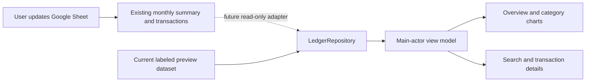
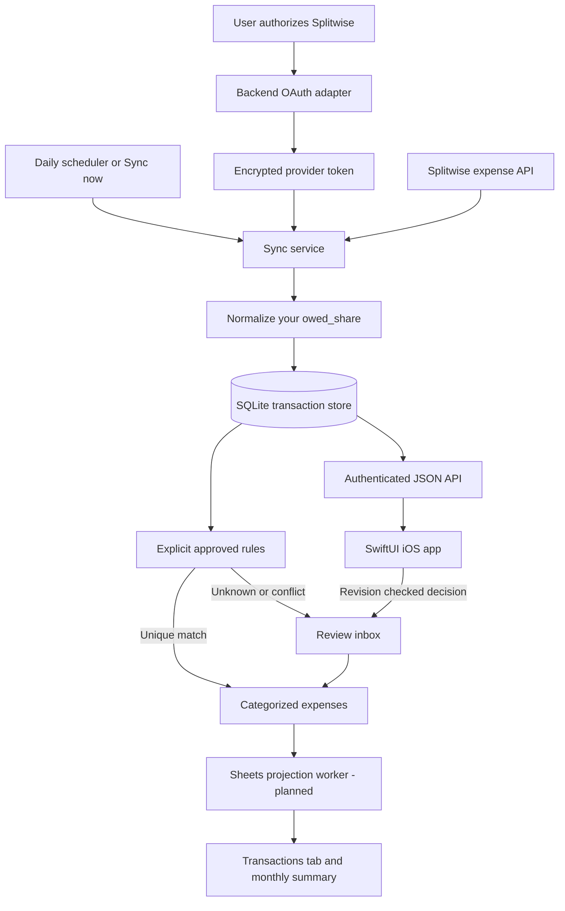

# Architecture and data correctness

## Current product direction

The user now maintains the Google Sheet manually. The immediate deliverable is the
native read-only iOS app under `ios/`, using an explicitly labeled snapshot until
sheet fetching is connected. See `ios/README.md`. Splitwise ingestion and category
automation below are retained as future design work, not prerequisites for the viewer.

## Scope

A personal, single-account iOS expense tracker. Splitwise supplies transactions and
your share; the backend owns review decisions; Google Sheets is a reporting view.
No AI is required. No Splitwise expense is created, edited or settled by this app.

## Boundaries

- `domain.py`: pure monetary normalization, exact category names and rule evaluation.
- `splitwise.py`: OAuth/provider calls and bounded incremental pagination.
- `store.py`: atomic writes, stable IDs, decision history and optimistic review checks.
- `api.py`: authentication, routes, service composition and single-worker sync exclusion.
- `cli.py`: local configuration and hooks for connecting and scheduled sync requests.
- Future Sheets adapter: retries and ID-based upserts. Native iOS app consumes the API.

SQLite is sufficient for the first single-user deployment. A hosted service with
multiple workers should migrate to PostgreSQL, migrations, a durable job queue,
database-backed sync leases and per-user identity. The current shared application
token is a local development credential; do not embed it in a distributed iOS app.

## OAuth flow

1. Register an application at https://secure.splitwise.com/apps with the callback
   `http://127.0.0.1:8000/oauth/splitwise/callback` (if localhost callbacks are accepted).
2. Store client credentials in the ignored local `.env`; the client secret stays server-side.
3. An authenticated POST to `/oauth/splitwise/start` creates a 10-minute random state
   and a connection URL. Opening it binds state to an HttpOnly SameSite cookie.
4. Splitwise redirects to the callback. Validate state, expiry and browser cookie;
   consume state once, exchange the code via Authlib, and verify the current user.
5. Persist the encrypted provider token. Never return it to the app or logs.
6. `/sync` verifies expense access. Connection alone does not prove expense access.

One connection attempt at a time is supported. Expired tokens require reconnecting
in this version; automatic refresh/revocation handling is a later integration task.
The encryption key must be backed up separately from the database. For deployment,
use HTTPS, a secret manager, restricted database file permissions and no query-string
logging at the reverse proxy. Run Uvicorn with `--no-access-log` locally.

## Sync and money

- Select the connected user's `owed_share`, never `paid_share` or `net_balance`.
- Missing/duplicate own shares or invalid monetary values fail the whole batch;
  the cursor stays unchanged rather than quietly losing spending.
- Use Decimal values, serialize amounts as strings, and keep currencies separate.
- Exclude payment/settlement records, deletion tombstones and zero-share expenses.
- Use the source expense date's calendar month for initial reporting. Confirm the
  intended date/timezone policy against real transactions before historical import.
- Fetch all pages within a fixed update-time window, overlapping the previous
  successful cursor by five minutes. Commit the complete batch and cursor together.
- Stable expense IDs make repeat syncs idempotent. A changed source fingerprint
  invalidates human category approval. Unchanged records preserve decisions.
- No records are removed merely because they are missing from a page. Deletion
  tombstones are handled, but real-account deletion visibility, API sort stability
  and pagination behavior still require verification. Add periodic reconciliation
  before relying on unattended production reporting.
- Backend sync runs independently of iOS background execution. Start with an
  external daily scheduler invoking the authenticated `/sync` hook. No schedule is
  installed or deployed by this scaffold.

## Categorization and review

All twelve user categories are explicit enum values. Unknowns never become Misc.
No merchant rules ship enabled. Human review can optionally remember an exact
normalized description, group and currency combination. Conflicts require review.
Remembered rules apply only to subsequently imported/changed records; they do not
silently bulk-reclassify existing pending records. New rule management and preview
will be added before large-scale rule use.

Human decisions include the source revision. A stale review receives HTTP 409.
Source changes and human decisions create append-only audit events. Pending
amounts are visible in summaries, separate from confirmed category totals.

Future mixed purchases need category allocations whose sum equals your share.
The initial API supports one category per transaction; mixed purchases should stay
pending until allocation support exists. No model confidence threshold can establish
correctness. If AI is added later, its output remains a suggestion requiring review.

## Sheets integration plan

Preserve the existing `2026` and `Transactions` tabs. The current transaction columns
are Date, Description, Category, My Share, Total Cost, Group / Friend and Expense ID.
The integration must use the exact domain category names, positive consumption
amounts for ordinary expenses, and Expense ID as the upsert key. Add currency,
review status, source revision and source update time explicitly rather than
guessing from existing values.

Add a durable export outbox in the same database transaction as each accepted change.
The Sheets worker retries failures and records the exported revision. Write literal
values with Sheets RAW input mode, not formulas derived from transaction text.
Keep pending records visibly pending; monthly formulas sum confirmed, active rows.
The app must show failed/stale export status. Category decisions flow through the app
API; direct Sheet editing and two-way conflict resolution are not in the first version.

Historical totals already exist in the sheet. Before any backfill, agree on a cutover
date and reconcile a sample period. Never add a full historical import on top of
manual summary totals. Refunds, gifts paid entirely for others and unusual shares
need explicit handling validated against the user's recording convention.

## Delivery sequence

1. **Current:** local repo, OAuth adapter, authenticated sync hook, transaction store,
   exact rules, review endpoints, monthly currency-separated summaries, automated tests.
2. Verify actual OAuth and expenses access using the user's registered client.
3. Add migration-managed persistence, Google Sheets authorization, export outbox,
   deletion reconciliation, allocations and an agreed historical cutover.
4. Build SwiftUI dashboard, transaction detail and review inbox, with secure app login,
   Keychain session storage and sync/export status.
5. Deploy backend plus daily scheduler; verify end-to-end reconciliation and backups.

Provider reference: https://dev.splitwise.com/ and
https://github.com/splitwise/api-docs/blob/main/splitwise.yaml
